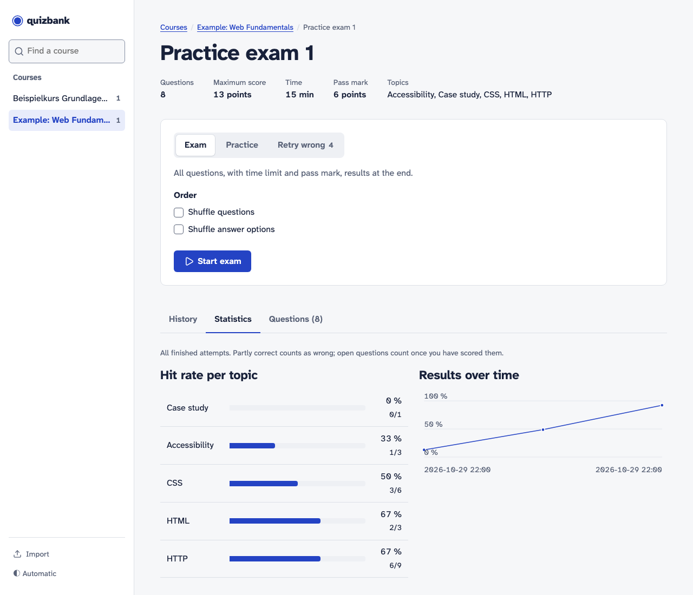
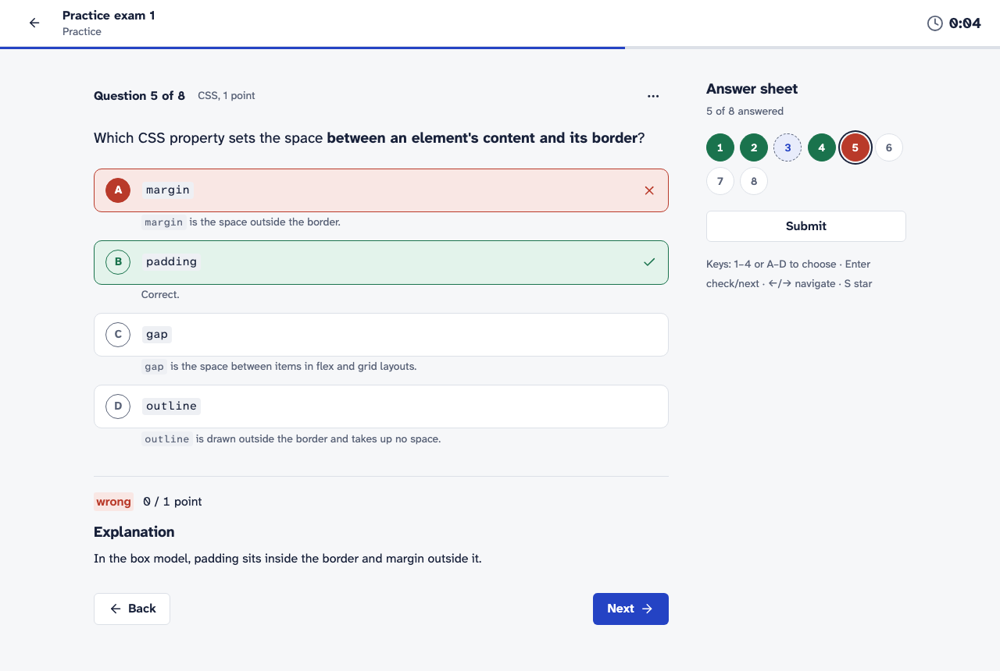
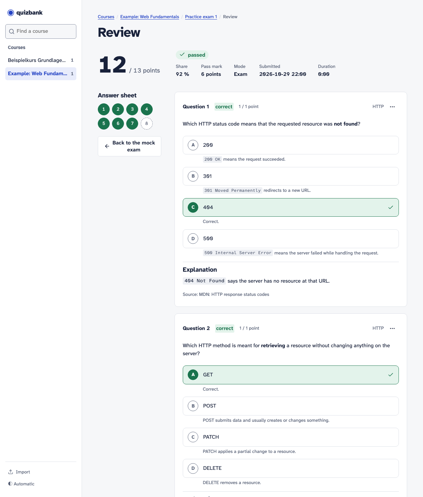

# quizbank

[](https://github.com/LordSpiegelei/quizbank/actions/workflows/ci.yml)
[](https://github.com/LordSpiegelei/quizbank/actions/workflows/docker.yml)

A self-hosted web app for practising mock exams. You bring your own question banks as JSON files, for example generated with Claude from your lecture notes. quizbank organises them by course and lets you drill them the way the real exam works: a timer, a pass mark, explanations for every answer, and a pool of the questions you got wrong.



> The user interface is in **English** by default; set `APP_LANG=de` for German. All texts live in [`app/locales/`](app/locales/), so another language is one more module with the same keys.

## Features

- **Exam mode:** all questions, a countdown with auto-submit, pass/fail against the exam's pass mark, and no solutions until you submit.
- **Practice mode:** filter by topic, tag or starred questions, pick a number of questions, and choose instant feedback or feedback at the end.
- **Wrong-answer pool** per exam: questions you got wrong stay in it until you answer them correctly twice in a row. You can retry just the pool.
- **Review page:** the correct option, an explanation per option and the source of each question.
- **Open questions (case studies):** write a free-text answer, compare it with the model answer and rubric, and score yourself per criterion. You can also copy the task and your answer as text to have Claude grade it.
- **History and statistics:** every attempt is kept, with a hit rate per topic and a chart of your results over time.
- **Shuffling** of questions and options, **keyboard shortcuts** (1–9 / A–J, Enter, ←/→, S) and a **light/dark** switch.
- **JSON import and export:** importing again is safe (questions are matched by `id`), and the export reproduces the file.

| Practice with instant feedback | Review after submitting |
|---|---|
|  |  |

## Quickstart (Docker)

```sh
git clone https://github.com/LordSpiegelei/quizbank.git
cd quizbank
docker compose up -d --build
```

Open <http://localhost:8000>. Your results are stored in `./data` (one SQLite file). Exam files you put into `./questions` are imported every time the app starts.

Released versions are also published as an image (`linux/amd64` and `linux/arm64`):

```sh
docker run -d -p 127.0.0.1:8000:8000 \
  -v "$PWD/data:/data" -v "$PWD/questions:/questions" \
  ghcr.io/lordspiegelei/quizbank:latest
```

> **There is no login.** quizbank is meant for a single person on their own machine and binds to `127.0.0.1`. Don't expose it to a network without putting authentication in front of it. If several people want to use it, run one instance each, with its own `./data`.

To try it out, copy the example exams from [`examples/`](examples/) into `./questions` and restart, or upload them on the **Import** page.

## Exam files

One JSON file is one mock exam. The full format is described by the JSON Schema in [`schema/exam.schema.json`](schema/exam.schema.json):

```json
{
  "format_version": 1,
  "course": "Example: Web Fundamentals",
  "title": "Practice exam 1",
  "time_limit_minutes": 15,
  "pass_mark": 6,
  "questions": [
    {
      "id": "web-p1-001",
      "type": "single",
      "topic": "HTTP",
      "tags": ["Status codes"],
      "question": "Which HTTP status code means **not found**?",
      "options": ["200", "301", "404", "500"],
      "correct": [2],
      "explanation": "`404 Not Found` says the server has no resource at that URL.",
      "option_explanations": ["…", "…", "Correct.", "…"],
      "source": "Lecture 2, slide 14"
    },
    {
      "id": "web-p1-008",
      "type": "open",
      "topic": "Case study",
      "scenario": "A small bakery's website loads very slowly on phones …",
      "question": "Suggest measures that make the home page load faster.",
      "points": 4,
      "model_answer": "…",
      "rubric": [
        { "criterion": "Resizes and compresses the images", "points": 2 },
        { "criterion": "Mentions lazy loading", "points": 2 }
      ]
    }
  ]
}
```

| Field | Notes |
|---|---|
| `course`, `title` | Together they identify the exam. The course is created on import if needed. |
| `time_limit_minutes`, `pass_mark` | Optional; otherwise the course defaults apply. |
| `multiple_scoring` | `all_or_nothing` (default) or `partial` for multiple-choice questions. |
| `id` | Unique within the file. Importing the file again updates questions with the same `id`. |
| `type` | `single` (exactly one correct option), `multiple` or `open`. |
| `topic`, `tags` | `topic` is required and drives filters and statistics; `tags` are optional keywords. |
| `options`, `correct` | 2–10 options; `correct` holds 0-based indices. |
| `points` | Default 1. Wrong answers never cost points. |
| `explanation`, `option_explanations`, `source` | Optional; shown after answering. |
| `scenario`, `model_answer`, `rubric` | Optional, for open questions. Rubric points may not add up to more than `points`. |

Text fields support **Markdown** (code, tables, emphasis). Math formulas are shown as written for now.

**The files are authoritative.** Questions you remove from a file are removed from the exam when you import it again. Past attempts keep a frozen copy of their questions, so your history stays intact. Stars, disabled questions and the wrong-answer pool are local learning state and are never part of a file. If an import fails, the error names the exact field, e.g. `questions[4].correct: index 5 out of range`.

## Generating exams with Claude

[`docs/generate-exam-prompt.md`](docs/generate-exam-prompt.md) has a ready-made prompt. Fill in your course, topics and number of questions, attach the schema and your own notes, and import the result. Keep files generated from copyrighted course material to yourself: `questions/` and `data/` are git-ignored for that reason.

## Configuration

| Variable | Default (local / Docker) | Meaning |
|---|---|---|
| `DB_PATH` | `./data/quizbank.db` / `/data/quizbank.db` | SQLite database file |
| `QUESTIONS_DIR` | `./questions` / `/questions` | Folder that is imported on start |
| `AUTO_IMPORT` | `true` | Set to `false` to skip the import on start |
| `PORT` | `8000` | Port inside the container |
| `APP_LANG` | `en` | UI language: `en` or `de` (a module in `app/locales/`) |

Database migrations run automatically on start. To back up, copy `data/quizbank.db` while the app is stopped.

## Development

Requires [uv](https://docs.astral.sh/uv/).

```sh
uv sync                                   # dependencies (and Python 3.12)
uv run pre-commit install                 # ruff on every commit
uv run uvicorn app.main:app --reload      # dev server on :8000
uv run pytest                             # tests
uv run ruff check . && uv run ruff format --check .
uv run python -m app.schemas              # regenerate schema/exam.schema.json
```

The stack is FastAPI, SQLModel/SQLite with Alembic migrations, Jinja2 templates, Alpine.js for the quiz page and a small hand-written CSS design system (`app/static/app.css`) with the Atkinson Hyperlegible fonts. There is no build step, and all front-end assets are vendored.

## Releases

Pushing a tag `vX.Y.Z` builds the image for amd64 and arm64 and publishes it to `ghcr.io/lordspiegelei/quizbank` with the tags `X.Y.Z`, `X.Y` and `latest`.

## License

[MIT](LICENSE)
